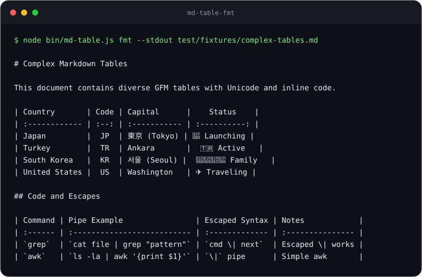

# md-table-fmt

[](https://github.com/YusufBeratZengin/md-table-fmt/actions/workflows/ci.yml)
[](LICENSE)
[](package.json)
[](https://www.npmjs.com/package/md-table-fmt)

Markdown tablolarını Unicode genişliğini gözeterek biçimlendirin, denetleyin, sıralayın ve dönüştürün; ek bağımlılık gerekmez.

[English](README.md) · [Türkçe](README.tr.md)



## Neden?

- **Unicode içeren tablolar da hizalı kalır.** CJK karakterlerini, birleşen işaretleri, bayrakları ve emoji dizilerini JavaScript karakter sayısına göre değil, görüntü genişliğine göre ölçer.
- **Belgenin içinde çalışır.** Ters tırnak ve tilde ile çevrili kod bloklarını atlar; tutarlı LF veya CRLF satır sonlarına sahip belgelerde çevredeki metni korur. Düzensiz satırları, fazla hücreleri kaybetmeden onarır.
- **Tek araç, sıfır bağımlılık.** GFM tablolarını biçimlendirin, denetleyin ve sıralayın; CSV, TSV veya JSON dönüşümlerini CLI ya da ESM API üzerinden yapın. `fmt --check` ile CI denetimi ekleyin.

## Hızlı başlangıç

Node.js 20 veya üzeri gerekir. Depoyu indirip doğrudan çalıştırabilirsiniz; paket kurmaya gerek yoktur:

```bash
git clone https://github.com/YusufBeratZengin/md-table-fmt.git
cd md-table-fmt
node bin/md-table.js from-json test/fixtures/sample.json
```

Çıktı:

```text
| id  | service       | status      | latency_ms |
| --- | ------------- | ----------- | ---------- |
| 1   | API Gateway   | operational | 12         |
| 2   | Database Auth | operational | 5          |
| 3   | Search Index  | degraded    | 140        |
```

Yukarıdaki görsel, şu komutun gerçek çıktısından üretilir:

```bash
node bin/md-table.js fmt --stdout test/fixtures/complex-tables.md
```

Paketin adı `md-table-fmt`, kurulumdan sonra kullanılacak komutun adı ise `md-table` olur. Paket yayımlandığında `npm install -g md-table-fmt` veya `npx --package md-table-fmt md-table --help` de kullanılabilir. İlk yayımdan önce npm rozeti sürüm gösteremeyebilir.

## Kullanım örnekleri

Aşağıdaki örnekler depo kökünden çalışır. Genel kurulum yaptıysanız `node bin/md-table.js` yerine `md-table` yazabilirsiniz.

### Biçimlendirme ve denetleme

```bash
# Belgeyi değiştirmeden biçimlendirilmiş çıktıyı göster
node bin/md-table.js fmt --stdout test/fixtures/complex-tables.md

# Belgeyi yerinde biçimlendir
node bin/md-table.js fmt README.md

# Standart girdiyi boru hattı (pipe) ile biçimlendir
cat test/fixtures/complex-tables.md | node bin/md-table.js fmt

# Biçimlendirme gerekiyorsa CI denetimini başarısız kıl
node bin/md-table.js fmt --check README.md README.tr.md

# Hizalama uyarılarını hata say
node bin/md-table.js lint --strict README.md README.tr.md

# Bir klasördeki tüm Markdown belgelerini denetle
node bin/md-table.js lint docs/
```

`fmt --check`, biçimlendirme gerekiyorsa `1`, gerekmiyorsa `0` çıkış kodunu döndürür. `lint`, hatalarda `1` döndürür; yalnızca hizalama uyarısı varsa başarısız olması için `--strict` gerekir. Denetleyici tutarsız sütun sayılarını, eksik başlık ayraçlarını, satır sonu boşluklarını ve hizasızlıkları bildirir.

Birden fazla dosya için dosya yolları, klasörler veya `"docs/**/*.md"` gibi tırnak içindeki desenler kullanılabilir. Klasörler alt klasörlerle birlikte `.md` ve `.markdown` dosyaları için taranır; `.git` ve `node_modules` atlanır. Desen desteği temeldir; açık dosya yolları veya klasörler daha öngörülebilir sonuç verir.

### CSV, TSV ve JSON dönüşümü

```bash
# CSV dosyasını veya standart girdiyi Markdown tablosuna dönüştür
node bin/md-table.js from-csv test/fixtures/sample.csv
cat test/fixtures/sample.csv | node bin/md-table.js from-csv

# Özel ayırıcı veya TSV
node bin/md-table.js from-csv --delimiter ";" data.csv
node bin/md-table.js from-csv --tsv data.tsv

# JSON verisini Markdown tablosuna dönüştür
node bin/md-table.js from-json test/fixtures/sample.json

# Markdown tablosunu CSV, TSV veya JSON biçimine geri dönüştür
node bin/md-table.js to-csv test/fixtures/complex-tables.md
node bin/md-table.js to-csv --tsv test/fixtures/complex-tables.md
node bin/md-table.js to-json --table 1 --indent 2 test/fixtures/complex-tables.md
```

Dönüşümler standart çıktıya yazılır. CSV ayrıştırıcısı tırnak içindeki alanları, çiftlenmiş tırnakları ve alan içi satır sonlarını destekler. Sekmeyle ayrılmış girdi için `from-csv --tsv`, özel bir ayırıcı için `--delimiter ";"` kullanın. Dosya belirtmezseniz veya `-` verirseniz standart girdi okunur.

### Satırları sıralama

```bash
# Sütun adına (harf duyarsız) veya 1 tabanlı sütun indeksine göre sırala
node bin/md-table.js sort --by Country test/fixtures/complex-tables.md
node bin/md-table.js sort --by 1 --desc test/fixtures/complex-tables.md

# Sayısal sıralamayı zorunlu kıl ve dosyayı yerinde güncelle
node bin/md-table.js sort --by Score --desc --numeric --in-place document.md

# Çok tablolu belgede belirli bir tabloyu hedefle (0 tabanlı indeks)
node bin/md-table.js sort --table 1 --by 2 document.md
```

Sıralama varsayılan olarak standart çıktıya yazılır; dosyayı güncellemek için `--in-place` ekleyin. Sütun adlarında büyük/küçük harf ayrımı yapılmaz. Sayısal sütun argümanları 1'den başlar (`0` da ilk sütunu seçer). Sayısal sıralama otomatik algılanır; `--numeric` ile zorunlu tutulabilir.

### JavaScript API

Depo içinden `./src/index.js` dosyasını içe aktarın. Paketin kurulu olduğu bir uygulamada bunun yerine `md-table-fmt` kullanın.

```javascript
import {
  formatMarkdown, formatTable, lintMarkdown, stringWidth,
  csvToMarkdown, jsonToMarkdown, markdownToJson, sortMarkdown,
} from './src/index.js';

// Veriyi dönüştür ve biçimlendir
const tablo = csvToMarkdown('item,score\nBeta,8\nAlpha,12');
const sirali = sortMarkdown(tablo, { by: 'score', desc: true, numeric: true });
console.log(formatMarkdown(sirali));
console.log(lintMarkdown(sirali)); // []
console.log(stringWidth('東京')); // 4
console.log(markdownToJson(sirali)); // Hücre değerleri metindir

// Ham tablo metnini doğrudan biçimlendir
const hizali = formatTable('|name|role|\n|---|---|\n|Alice|admin|');
console.log(hizali);

// JSON nesnelerini Markdown tablosuna dönüştür
const jsonTablo = jsonToMarkdown([{ id: 1, name: 'Alice' }, { id: 2, name: 'Bob' }]);
console.log(jsonTablo);
```

API ayrıca `formatTable`, `formatTableLines`, `formatDelimiterCell`, `formatLintReport`, `tsvToMarkdown`, `markdownToCsv`, `markdownToTsv`, `jsonToMarkdown`, `sortTableAST` ile ayrıştırma ve genişlik yardımcılarını dışa aktarır. Tüm dışa aktarımlar için [src/index.js](src/index.js) dosyasına, JSDoc seçenekleri için ilgili uygulama modüllerine bakın.

## Yapılandırma

Yapılandırma dosyası veya ortam değişkeni ayarı yoktur. CLI seçeneklerini ya da JavaScript seçenek nesnelerini kullanın.

| Seçenek             | Kapsam                   | Varsayılan / davranış                                         |
| ------------------- | ------------------------ | ------------------------------------------------------------- |
| `--check`, `-c`     | `fmt`                    | Yazmadan denetler; değişiklik gerekiyorsa çıkış 1             |
| `--stdout`          | `fmt`                    | Belirtilmezse dosyalar yerinde güncellenir                    |
| `--strict`          | `lint`                   | Hizalama uyarıları hata sayılır                               |
| `--delimiter`, `-d` | CSV dönüşümleri          | Virgül; tek karakter kullanın                                 |
| `--tsv`             | CSV dönüşümleri          | Sekme ayırıcı                                                 |
| `--table`           | Dışa aktarma ve sıralama | Sıfır tabanlı tablo indeksi; varsayılan 0                     |
| `--indent`          | `to-json`                | 2 boşluk                                                      |
| `--by`, `-b`        | `sort`                   | Sütun adı veya indeksi; zorunlu                               |
| `--desc`            | `sort`                   | Azalan sıralama; varsayılan artan                             |
| `--numeric`         | `sort`                   | Sayısal karşılaştırmayı zorlar; aksi halde otomatik algılanır |
| `--in-place`        | `sort`                   | Girdi dosyasını günceller; varsayılan standart çıktı          |

Komut başvurusu için `node bin/md-table.js --help` çalıştırın. API biçimlendirme seçenekleri arasında `alignHeader`; dönüşüm seçenekleri arasında ise işleve göre `alignments`, `delimiter`, `tableIndex` ve `indent` bulunur.

## Sık sorulanlar / Sınırlamalar

**Tüm Markdown sözdizimini ayrıştırır mı?** Tam bir CommonMark ayrıştırıcısı olmak yerine dikey çizgili tablolara ve çitle çevrili kod bloklarına odaklanır. Biçimlendirme için ayraç satırı gerekir; `lint`, ayraç satırının eksik olabileceği yerleri bildirebilir.

**Unicode her terminalde aynı görünür mü?** Genişlik hesabında üretilmiş geniş/sıfır genişlikli karakter aralıkları ile `Intl.Segmenter` karakter kümeleri kullanılır. Gerçek görüntü, özellikle emojilerde, terminale ve yazı tipine bağlıdır.

**Dönüşümlerde veri türleri korunur mu?** Dışa aktarılan JSON hücre değerleri metindir. Girdi JSON nesnelerindeki tüm anahtarlar birleştirilerek başlıklar oluşturulur; dizi içinde diziler varsa ilk satır başlık kabul edilir. Dikey çizgiler kaçışlanır ve hücre içi satır sonları `<br>` olur. Dışa aktarımda düz `<br>` metni de satır sonuna çevrilir. Yinelenen JSON başlıkları önceki değerlerin üzerine yazar; benzersiz başlıklar kullanın.

**Satır sonları ve diğer tablolar ne olur?** Belge biçimlendirilirken tutarlı LF veya CRLF satır sonları korunur; karışık satır sonları CRLF olarak birleştirilir. Sıralama tek tabloyu hedefler ama belgedeki tüm ayrıştırılmış tabloları biçimlendirir. Dışa aktarımda sınır dışı bir tablo indeksi ilk tabloyu seçer.

**CommonJS ile kullanılabilir mi?** Paket ESM biçimindedir. CommonJS içinden dinamik `import('md-table-fmt')` kullanın.

## Katkıda bulunma

Kurulum ve pull request kuralları için [CONTRIBUTING.md](CONTRIBUTING.md) dosyasına bakın. Hata bildirimleri ve özellik istekleri Türkçe veya İngilizce yazılabilir. Güvenlik açıklarını özel olarak bildirmek için [SECURITY.md](SECURITY.md) dosyasını kullanın.

```bash
npm test
npm run lint
npm run demo:check
```

`npm test`, Node'un yerleşik satır, dal ve işlev kapsam raporunu yazdırır. Node.js 22.8 veya üzerinde `npm run test:coverage`, üretilmiş Unicode veri tablosunu hariç tutarak `src/` için en az %85 satır kapsamını zorunlu kılar; CI bu denetimi Node.js 22 üzerinde çalıştırır. Çalışma zamanı veya test paketi kurmak gerekmez. Ayrı bir typecheck komutu henüz yapılandırılmamıştır.

SVG görselini `npm run demo`, Unicode aralık verisini `npm run generate-data` ile yeniden üretin. CI, Ubuntu, Windows ve macOS üzerinde Node.js 20 ve 22 ile kapsam raporlu testleri çalıştırır; CodeQL ve haftalık Dependabot güncellemeleri ayrı yapılandırılmıştır.

Sürümdeki değişiklikler [CHANGELOG.md](CHANGELOG.md) dosyasındadır.

## Lisans

[MIT](LICENSE).
